# Salonova: Salon ERP

## Project Case Study

A full-stack ERP for salons that runs the whole business day in one web application: booking customers with a stylist and a chair, billing services and retail products with GST, selling memberships, prepaid service packages and gift cards, tracking the stock each service consumes, and paying staff their salary, commission and tips. Every sale, purchase, payroll run and expense posts to a double-entry ledger automatically, so the books stay balanced without manual bookkeeping. It is built for Indian salons (GST, PF/ESI/Professional Tax, April–March financial year) and runs in production.

## Business Problem

A salon's revenue is earned chair by chair: each service is delivered by a specific stylist, uses up professional products, and often earns that stylist a commission. Front-desk staff need a fast way to book and bill; owners need to know which services and which staff bring in revenue, what stock is running low, and what they owe in GST and payroll. Prepaid memberships, packages and gift cards also need to be tracked as liabilities until they are used, and all of it has to reconcile with the accounts.

## Core Features

**Front desk and services**
- Appointments with staff and bookable resources (chairs, rooms, equipment), with double-booking checks for both
- Reschedule, cancel, mark no-show, and convert a confirmed appointment straight into a GST invoice
- Service catalog with duration, and service consumption: record the professional products used while delivering a service

**Sales and customer loyalty**
- Customers, sales orders, invoices with CGST/SGST or IGST by place of supply, credit notes and printable invoices
- Customer payments, advances, payment plans, statements and receivables ageing
- Memberships and prepaid service packages (session bundles): sell, redeem, cancel and expire automatically
- Gift cards with deferred-revenue accounting; loyalty points; discount coupons with a preview before use

**Inventory and purchasing**
- Products, warehouses and weighted-average costing, with cost of goods sold posted on each sale
- Batches with recall and write-off, stock transfers, physical counts and stock adjustments, all with approval
- Low-stock alerts, replenishment suggestions, and barcode product labels
- Full procurement chain: requisitions, requests for quotation, supplier quotation comparison, purchase orders, goods receipts, purchase invoices (input tax credit, freight allocation, Section 194Q TDS) and supplier payments

**HR and payroll**
- Employees, departments, documents, onboarding, transfers, promotions, and exit with full and final settlement
- Attendance, shifts, staff roster, shift-swap requests, weekly offs, holidays and overtime
- Leave types, balances, requests and approvals
- Salary structures and monthly payroll with a review and approval workflow, and payslips
- Service commission with graduated slabs, tips, and staff loans recovered through payroll
- Statutory compliance: configurable PF/ESI rates and Professional Tax slabs, with filing tracking and CSV export
- Performance targets, appraisals and an HR dashboard

**Accounting, GST and reports**
- Chart of accounts, journal entries, financial years with locking, bank and cash accounts, cash handovers
- Income and expenses with approval, receipts and recurring templates
- Trial balance, profit and loss, balance sheet; GSTR-1 and GSTR-3B summaries
- Reports: service revenue, staff commission, product consumption, stock valuation, stock ageing, slow-moving stock, turnover and margin

**Platform**
- Role- and group-based access control with explicit deny rules (7 roles, 5 groups, 24 features, 5 actions each)
- Activity history on business records, notifications and file attachments
- CSV exports for expenses, income, stock movements, the purchase register and statutory filings

## Application Screenshots

*Screenshots use synthetic demo data: fictional customers, staff, phone numbers and amounts.*

| Appointments | Invoice with stylist attribution |
|---|---|
| 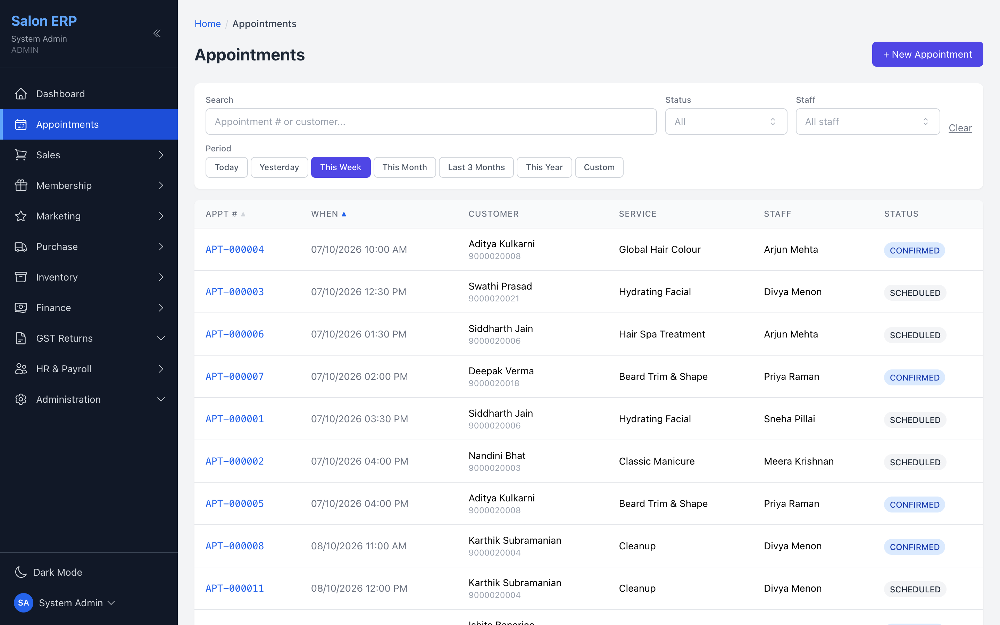 | 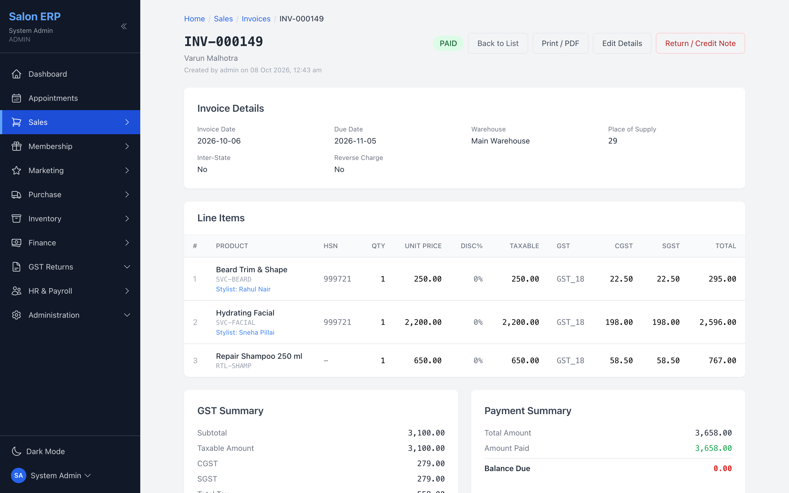 |
| **Service revenue report** | **Commission report** |
| 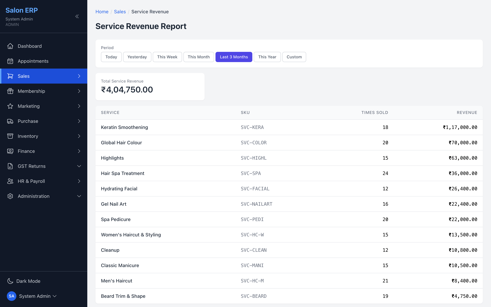 | 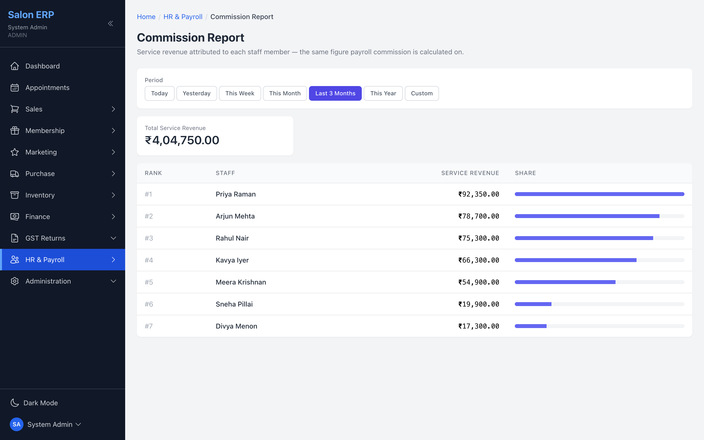 |
| **Memberships** | **Service packages** |
| 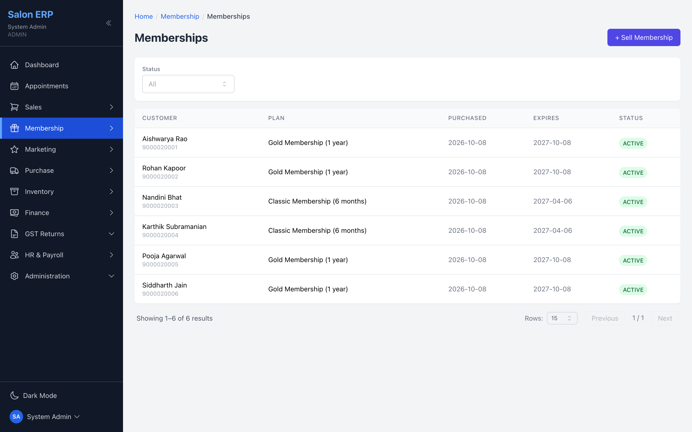 | 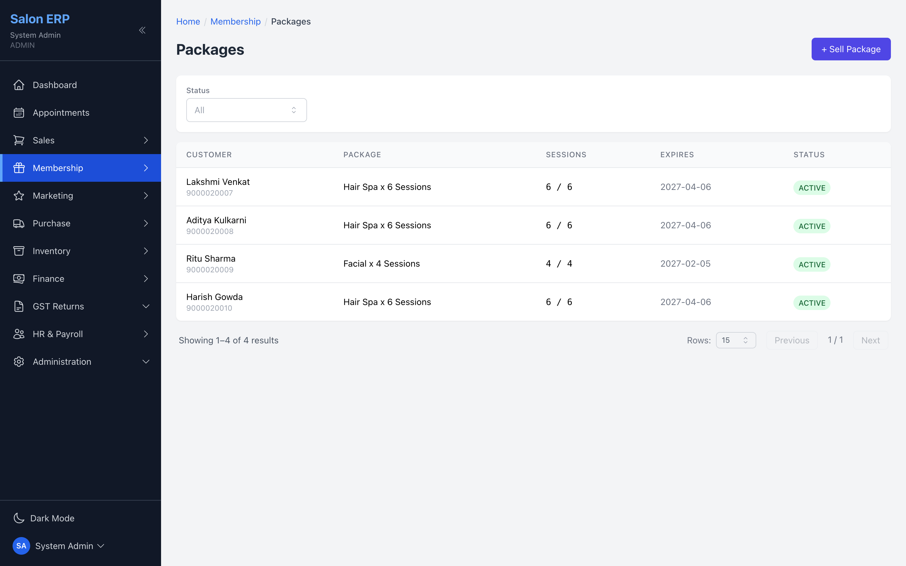 |
| **Inventory dashboard** | **HR dashboard** |
| 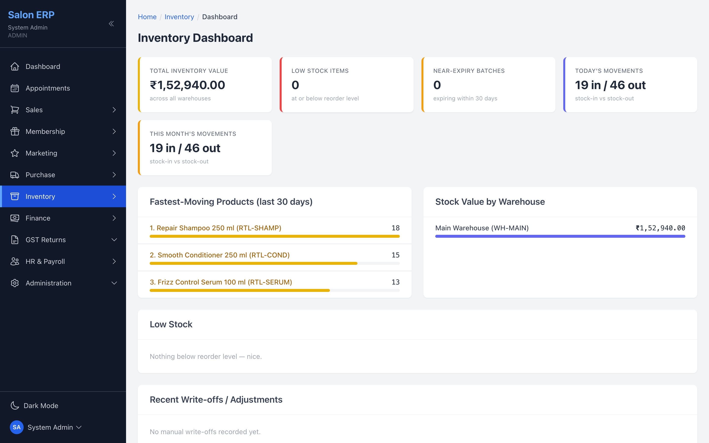 | 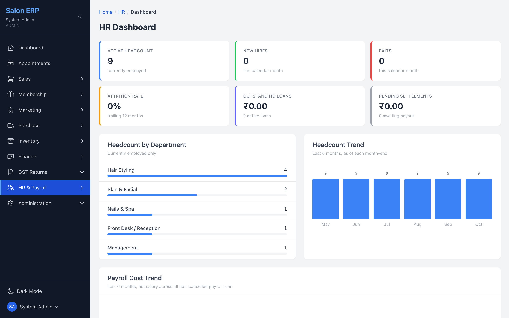 |
| **Home dashboard** | **Profit and loss** |
| 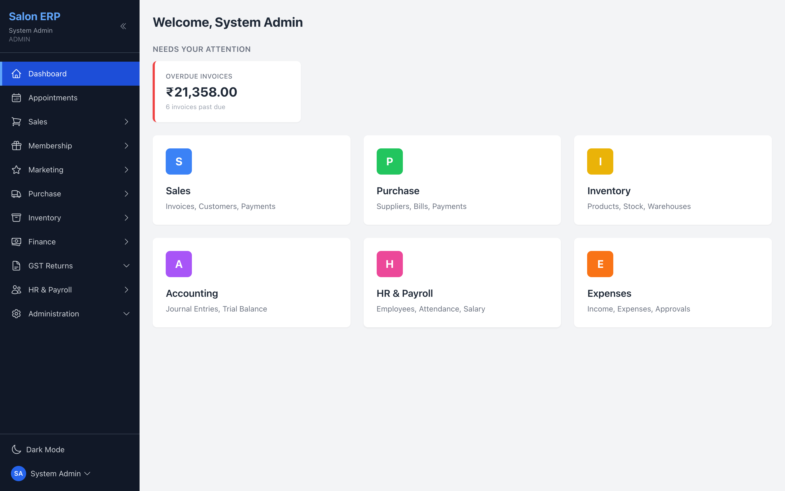 | 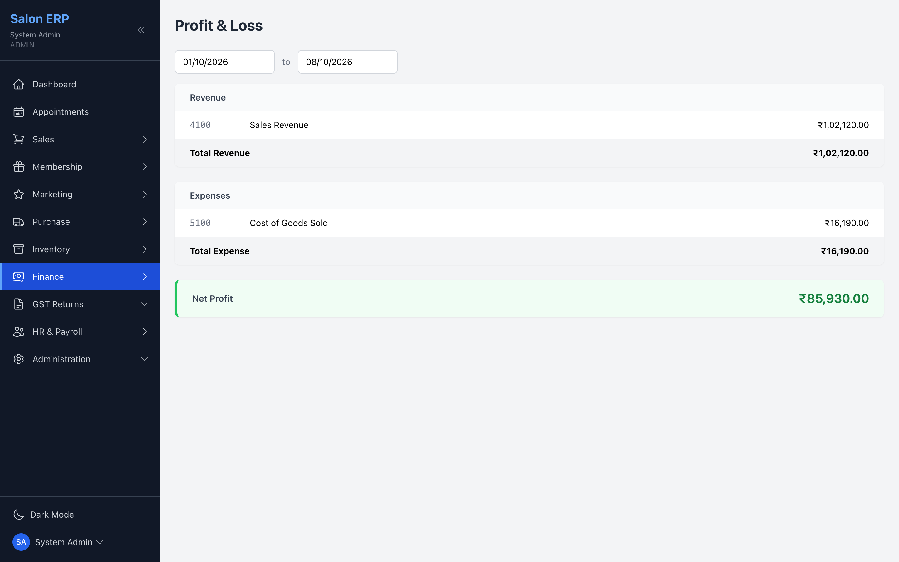 |

## Technology Stack

| Area | Technologies |
|---|---|
| Backend | Java 17, Spring Boot 3.2, Spring Security |
| Authentication | JWT, BCrypt |
| Database | PostgreSQL |
| Persistence | Spring Data JPA, Hibernate |
| Database migrations | Flyway (HR and payroll module), Hibernate schema updates elsewhere |
| Mapping | MapStruct, Lombok |
| Web frontend | React 18, TypeScript, Vite, Tailwind CSS, React Router |
| State and API calls | React Context, Axios |
| Backend testing | JUnit 5, AssertJ, Spring Data JPA tests on H2 |
| Build and deployment | Maven, shell and Windows batch scripts (web app packaged into the backend JAR) |

## Architecture

### System overview

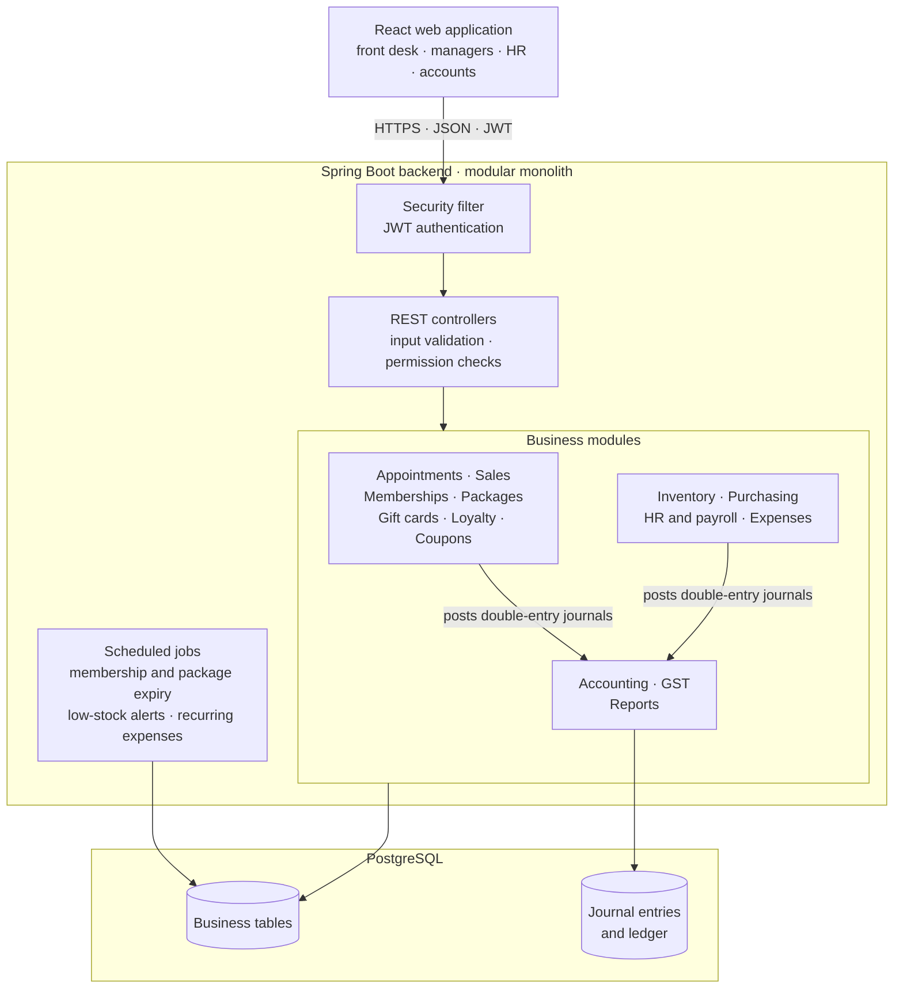

- **Client:** one React web application for every role; menus and buttons are shown or hidden according to the user's permissions.
- **Backend:** one Spring Boot application organised as a modular monolith, with a module per business area. Each module follows the same layers: controller, service (business rules and transactions), repository and entity.
- **Security:** every request passes JWT authentication; controllers validate input and check the user's permission for that feature and action before any business logic runs.
- **Accounting integration:** modules never update balances directly. They send balanced posting lines to the accounting service, which validates them and writes the journal entry.
- **Background jobs:** memberships and packages past their validity are expired daily, low-stock alerts are sent each morning, and recurring expenses are generated on schedule.
- **Deployment:** the web application is built into the backend JAR, so one process serves both the API and the web interface.

### Checking out an appointment, step by step

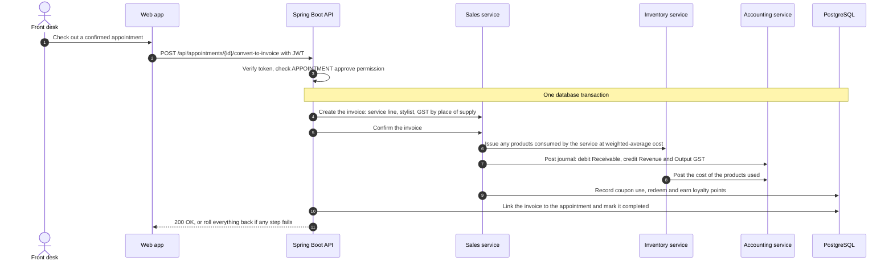

A checkout either updates the invoice, stock, ledger, loyalty balance and appointment together, or changes nothing. Cancelling the invoice later reverses each of these steps.

## Business Rules

- A stylist cannot have two live appointments that overlap, and a chair or room cannot be double-booked.
- Only a confirmed appointment can be converted to an invoice; converting it completes the appointment.
- Tax is CGST plus SGST when the customer is in the salon's state, and IGST otherwise.
- Only a draft invoice can be confirmed; stock, accounting, coupon use and loyalty points are recorded at confirmation, not while the invoice is a draft.
- Only physical retail products carry stock. Services, memberships and packages never do, but the products a service consumes are taken out of stock and costed.
- Gift card sales are held as a liability and recognised as revenue only when the card is spent.
- Staff commission is calculated on the service revenue attributed to each stylist, using graduated slabs.
- Every journal entry must balance, cannot be posted to a locked financial year, and is corrected by a reversing entry rather than an edit.
- Payroll, stock adjustments and physical counts use maker-checker approval: the person who prepared them cannot approve them.
- Access to every operation is controlled through roles, groups and permissions; an explicit deny overrides any allow.

## Engineering Highlights

- Server-side permission checks on every business endpoint, with a rule engine that resolves deny, group and role rules
- Double-entry accounting shared by every module, with balanced-entry validation and reversal-based corrections
- Gap-free document numbering using row-locked counters, so concurrent requests cannot take the same number
- Optimistic locking on stock rows to prevent lost updates when two sales touch the same product
- Monetary amounts held as exact decimals (BigDecimal) throughout
- Deferred-revenue accounting for gift cards, and loyalty points clawed back when an invoice is cancelled
- Configurable statutory rates (PF/ESI, Professional Tax, purchase TDS) stored as settings rather than hard-coded
- Service-layer transaction management across modules, reusing each module's own creation logic instead of duplicating it
- Activity history and audit fields (created and updated by and at) on business records
- Idempotent startup seeding that layers new features and permissions onto existing databases

## Testing and Validation

The backend has 123 automated tests across 19 test classes, written with JUnit 5 and AssertJ. Most are Spring Data JPA tests that run the real services against an in-memory H2 database rather than mocks. The largest suite covers payroll calculation (29 tests); others cover purchasing, purchase orders, quotations, supplier credit notes, statutory compliance, performance and appraisals, the HR dashboard, accounting reports and GST returns.

### Current Coverage Limits

- The newer salon modules (appointments, memberships and packages, gift cards, loyalty, coupons, reports) and the stock transfer and physical count flows do not yet have automated tests.
- There are no frontend or end-to-end tests; the frontend is checked with the TypeScript compiler.

## Known Limitations and Next Steps

- **Fresh installation:** the HR migrations run before the rest of the schema exists, so a brand-new database needs a two-step first start. Next step: move the whole schema to versioned migrations.
- **Mixed schema management:** Flyway manages only the HR module; the rest relies on Hibernate schema updates. Next step: baseline the full schema in Flyway.
- **Commission on retail sales:** commission is earned only on services, not on product sales. Next step: configurable commission for retail items.
- **Income tax on salaries:** TDS on salary is not calculated; the payroll screen warns about this. Next step: an annual tax projection engine.
- **Session handling:** a refresh token is issued at sign-in but the web app does not yet use it, so users sign in again when the access token expires. Next step: silent token refresh.
- **Single location:** there is no branch concept yet. Next step: branch-scoped data if the business grows to several outlets.

## My Contribution

Handled requirements, application design, backend and frontend development, testing, deployment, and server maintenance.

## About This Repository

This repository presents the project's business context, architecture, and engineering approach as a portfolio case study.
